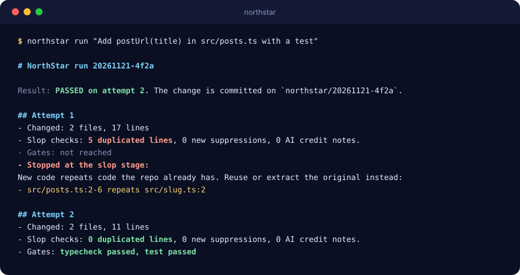
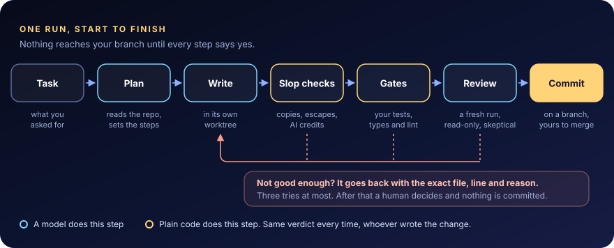

<p align="center">
  
</p>

<p align="center">
  <a href="#quick-start">Quick start</a> ·
  <a href="#how-a-run-works">How it works</a> ·
  <a href="#what-gets-stopped">What gets stopped</a> ·
  <a href="#tips-that-pay-off">Tips</a> ·
  <a href="#prove-it-on-your-own-code">Prove it</a> ·
  <a href="#where-this-stands">Where this stands</a>
</p>

Coding agents type faster than anyone you have ever worked with. They will also paste the same helper into three files, write a test that cannot fail, slip in an `as any` to quiet the type checker, and then tell you it all went great.

NorthStar is the colleague who reads the diff before it lands.

It puts your agent inside a pipeline: a plan, a writer, a set of checks that are plain code and cannot be sweet-talked, and a reviewer that starts from zero and takes nothing on trust. A change that clears all of it is committed on its own branch. A change that doesn't goes back with the exact file, line, and reason. Three tries, then a human decides.

The bar is simple to say and hard to hold: **code a person can read and maintain.** No duplicated helpers. No dead code. No drive-by edits. No "the tests pass" when the tests test nothing.

It runs on **Codex alone**. One signed-in CLI does every job, and nothing else has to be installed.

## See it catch something

<p align="center">
  
</p>

That is a real report from the pipeline, trimmed to fit, with scripted agents standing in for Codex. The first attempt pasted five lines out of a helper the repo already had. It was stopped before a single test ran and told exactly where the original lives. The second attempt called the helper and went through.

## Quick start

You need Node 20 or newer, git, and the Codex CLI signed in (`codex login`).

```bash
git clone https://github.com/melaniesigrid/northstar.git
cd northstar
npm install && npm run build && npm link
```

Then, in the repo you want to work on:

```bash
northstar init      # reads your package.json and writes the config for you
northstar doctor    # is Codex installed and signed in? Free, no model call
northstar run "Add a slugify helper to src/strings.ts with tests"
```

`init` turns the scripts your repo already has into gates: type check, lint, tests. It picks the right install command from your lockfile, writes a convention profile, and adds `.northstar/` to `.gitignore`. It never overwrites a config you already have.

> [!TIP]
> No agent signed in yet? Run `northstar audit`. It needs no config and no model, takes about a minute, and shows what the checks would have said about your last 30 commits.

## How a run works

<p align="center">
  
</p>

Your checkout is never touched. Every run gets its own branch and its own worktree, and the only thing that ever comes out of it is one commit you can merge or throw away.

<details>
<summary><b>The same thing, step by step</b></summary>

<br>

1. NorthStar creates a branch `northstar/<run id>` in its own worktree.
2. Setup commands run once, for example `npm ci`.
3. It reads the repo's conventions and finds existing helpers that relate to the task.
4. If a planner is configured, it reads the repo and writes a short plan with done-when checks.
5. The writer makes the change. Its brief holds the task, the plan, your rules, the relevant helpers, and every limit it will be checked against.
6. The change is staged and checked against the line budget.
7. The slop checks run on what the change added.
8. Each gate runs in order. A gate is any command that exits 0 on success.
9. The reviewer reads the staged diff in a fresh read-only run and returns findings as structured output. Anything it writes is discarded.
10. A failed check or a blocking finding goes back to the writer with the exact reason.
11. On success the change is committed on the branch. After `maxIterations` failures the run stops and a human decides.

Two rules keep the loop honest. A run stops the moment the writer answers feedback with exactly the change it made before, because another try would end the same way. And thresholds are never relaxed to make a run pass. A review that cannot be parsed is never treated as a pass either.

</details>

## What gets stopped

Every check looks only at the lines a change added. Code that was already there is never held against it. Add no new debt: that is the whole rule.

| Check | What it catches | What happens |
| --- | --- | --- |
| **Duplication** | Five or more lines copied from somewhere in the repo | Blocked, with the location of the original |
| **Suppressions** | New `as any`, `@ts-ignore`, `eslint-disable` and friends | Blocked |
| **AI credits** | Any added line that credits an AI tool, in code or docs | Blocked |
| **Line budget** | A change too big to review in one sitting (400 lines by default) | Blocked |
| **Your gates** | Whatever your tests, types, and lint say | Blocked |
| **Weak tests** | Tests with no assertion, or that only check a value exists | Pointed out to the reviewer |
| **Complexity** | Functions the change pushed past a cognitive complexity of 15 | Pointed out to the reviewer |
| **Dead code** | New top-level names that nothing else uses | Pointed out to the reviewer |
| **Repeated data** | Copied lists of literals and field mappings | Pointed out to the reviewer |

Why do some block and some only get pointed out? House rule: **a check may block only after replaying real commit history showed its findings were deserved.** Everything else is a signal for the reviewer, who can read the repo and use judgment.

Then the reviewer looks for what plain code cannot see: a helper rewritten under new names, a test that passes either way, a query inside a loop, an edit nobody asked for, an abstraction with one user.

And when it is all done, the work reads as written by your team. No tool signatures, no credit lines, and a commit message that is the task and nothing else.

Every rule, with its limits spelled out: [`docs/CHECKS.md`](docs/CHECKS.md).

## Tips that pay off

**1. Brief it like you would a colleague.** "Add a slugify helper to `src/strings.ts` with tests" gets you a better change than "add slugify". Say where it goes and what done looks like.

**2. Keep tasks small.** The 400 line budget is on purpose. If a task will not fit, it is two tasks.

**3. Write three house rules, not thirty.** The `notes` in `northstar.profile.json` reach every agent word for word. A rule earns its place when an agent has made the mistake it prevents. Research on agent context files found that broad, general ones lower task success and raise cost, while short and specific ones help.

```json
{ "notes": ["Store dates in UTC.", "Server components by default. Add \"use client\" only for interactivity."] }
```

**4. Gates check, they do not fix.** Anything a gate writes is thrown away. Use `prettier --check`, not `prettier --write`.

**5. Give the reviewer a different model if you have one.** Set `reviewerModel`. One model checking its own work shares its own blind spots.

**6. Measure before you trust.** Two commands tell you whether your reviewer is too strict or too easy. They are in the next section, and they take minutes.

**7. "Needs a human" is the system working.** The worktree is left in place for you, and the report names the check that stopped the run and why.

## Prove it on your own code

Nobody should take a quality tool at its word, including this one. So it ships with four ways to check it against your own repo.

| Command | Question it answers | Needs |
| --- | --- | --- |
| `northstar audit` | What would the checks have said about my recent commits? | Nothing. No config, no model |
| `northstar calibrate` | Does the reviewer block work a person already accepted? | Codex |
| `northstar calibrate --seeded` | Does the reviewer miss real problems? | Codex |
| `northstar bench` | Is the pipeline's code cleaner than the agent's alone? | Codex, and patience |

**`audit`** replays the slop checks over your history in a scratch worktree and gives you rates per 1,000 added lines.

**`calibrate`** shows the reviewer your last 10 commits exactly as a run would, and counts how many it would have blocked. A person accepted every one of them, so each block is either the reviewer catching something that slipped through or the reviewer being too strict. You read them and decide.

**`calibrate --seeded`** tests the opposite mistake. It runs the reviewer over ten small hand-built changes with a known right answer: seven with one problem each that plain code cannot see, and three clean versions of the same tasks. A miss on cases this obvious tells you a lot. Add your own with `--cases <folder>`. The mistakes your team actually makes are the best test there is.

**`bench`** is the big one. It runs each task twice from the same commit, once with the agent alone and once through the pipeline, and scores both with the same checks. Tokens, cost, and time sit right next to the result, so the price of the extra quality is never hidden.

Step by step, with what each result should make you do next: [`docs/FIRST-LIVE-RUN.md`](docs/FIRST-LIVE-RUN.md).

## Where this stands

Early, and honest about it.

> [!NOTE]
> Every check has been replayed against real commit history: 74 commits across six repos, with each block read by hand. The CLI adapters have been run against the real Codex binary up to the sign-in step.
>
> What has **not** happened yet is the head to head: Codex alone against Codex through the pipeline, signed in, on real tasks. Until it has, you will not find a benchmark number in this README. When the numbers exist they go in [`docs/EXPERIMENTS.md`](docs/EXPERIMENTS.md), good or bad.

Still to build: pull request creation, a rebuttal round for the writer, and convention rules proposed by an agent.

## Codex is all you need

Every role is done by Codex unless your config says otherwise. This is a complete config:

```json
{
  "planner": "codex",
  "writerEffort": "high",
  "reviewerEffort": "high",
  "setup": ["npm ci"],
  "gates": [
    { "name": "typecheck", "command": "npm run typecheck" },
    { "name": "test", "command": "npm test" }
  ]
}
```

What the pipeline adds to Codex working alone:

- **A plan first.** A read-only run reads the repo and decides which files change, what to reuse, which tests to add, and what done means. The writer spends its effort on writing.
- **A short brief.** Codex's own guidance is that coding models do worse when over-prompted, so the writer gets the task, the plan, your rules, and its limits. Little else.
- **No surprises.** The writer is told the exact commands it will be checked with and may run them itself first.
- **Checks no model can argue with.** Gates, the line budget, and the slop checks are plain code. Same verdict whoever wrote the change.
- **A review from zero.** The reviewer is a new process, read-only, that never saw the writer's session.
- **Exact rejections.** File, line, reason. That is what a model needs to fix something in one more try.

<details>
<summary><b>Is one model reviewing its own work worth anything?</b></summary>

<br>

Less than a different model, and more than nothing.

The lenience that research measures in models judging their own output comes from the work showing up as the model's own earlier turn. Handed the same work as new material in a separate context, a model judges it more strictly. NorthStar's reviewer always runs that way. What a fresh run cannot remove is the blind spots a model shares with itself.

So in a Codex-only setup, the plain code carries more of the weight, and the review is a second look rather than the guarantee. The run report always says which kind of review a change got. The reasoning and the sources are in [`docs/RESEARCH.md`](docs/RESEARCH.md), decision 4.

Other agents sit behind the same interface. If you add one later, set `"reviewer": "claude-code"` and nothing else changes.

</details>

## It learns your repo before it writes

Before the writer starts, NorthStar scans how the repo is written (file naming, test layout, main folders, libraries in use) and searches for existing code that relates to the task:

```
Existing helpers that look relevant. Reuse them instead of writing new ones:
- formatDueDate (src/dates.ts:10)
- mean (src/features/causal.ts:55, not exported yet)
```

The planner and the reviewer get the full picture. The writer gets less on purpose: your hand-written rules and the relevant helpers. Run `northstar profile` to save the scan as `northstar.profile.json`, then edit it and commit it.

More in [`docs/CONVENTIONS.md`](docs/CONVENTIONS.md).

## Commands

| Command | What it does |
| --- | --- |
| `northstar init` | Sets a repo up from its own scripts |
| `northstar doctor` | Checks that the agents you use are installed and signed in. Free |
| `northstar doctor --live` | Also proves each one answers, with the model you configured |
| `northstar run "<task>"` | Runs one task through the pipeline |
| `northstar audit` | Scores your recent commits with the slop checks |
| `northstar calibrate` | Measures the reviewer on commits you accepted |
| `northstar calibrate --seeded` | Measures what the reviewer misses |
| `northstar bench` | Compares the agent alone with the pipeline |
| `northstar profile` | Writes the convention profile |

Exit codes: `0` the change passed and is committed on its branch, `1` a human needs to look, `2` usage or setup error.

Reports are printed and saved with a JSON log under `.northstar/`. A run that stops for a human leaves its worktree in place so you can read the work. A run in which no file changed has nothing to read, so it cleans up after itself and says so.

<details>
<summary><b>Config reference</b></summary>

<br>

| Key | Required | Default | Meaning |
| --- | --- | --- | --- |
| `gates` | yes | | List of `{ "name", "command" }`. At least one |
| `writer` | no | `codex` | Agent that writes: `codex` or `claude-code` |
| `reviewer` | no | `codex` | Agent that reviews, always in its own read-only run |
| `planner` | no | none | Agent that plans before the writer starts |
| `setup` | no | `[]` | Commands run once in the fresh worktree |
| `writerModel`, `reviewerModel`, `plannerModel` | no | CLI default | Passed to the agent's `--model` flag |
| `writerEffort`, `reviewerEffort`, `plannerEffort` | no | CLI default | `low`, `medium` or `high` |
| `writerConventions` | no | `notes` | `notes` gives the writer your rules only. `all` adds the scanned conventions |
| `maxIterations` | no | `3` | Writer attempts before a human takes over |
| `maxChangedLines` | no | `400` | Line budget for one change |
| `minDuplicateLines` | no | `5` | Length of a repeated block that counts as a clone |
| `maxNewSuppressions` | no | `0` | New lint or type suppressions a change may add |
| `agentTimeoutMs` | no | `900000` | Time limit for one agent turn |
| `gateTimeoutMs` | no | `300000` | Time limit for one gate or setup command |

</details>

<details>
<summary><b>Signed out? You will know in seconds</b></summary>

<br>

A signed-out Codex with no network does not fail. It waits. So NorthStar asks Codex for its own login status before every run, which costs nothing:

```text
codex: installed (codex-cli 0.171.0), NOT SIGNED IN. No sign-in is stored. Run `codex login`.
```

`northstar doctor --live` goes one step further and asks each agent for a one-word answer with the model your config names, which also catches a mistyped model name. `bench` and `calibrate` run that check before they spend anything.

</details>

## Your credentials stay yours

NorthStar never reads, stores, or forwards credentials. It starts the vendor's own unmodified CLI, which uses whatever sign-in you set up for it. The sign-in check asks the CLI whether a sign-in exists and looks only at the yes or no. Your vendor bills you directly.

## Go deeper

| | |
| --- | --- |
| [`docs/RESEARCH.md`](docs/RESEARCH.md) | Twelve design decisions, the evidence behind each, and how each will be tested |
| [`docs/EXPERIMENTS.md`](docs/EXPERIMENTS.md) | The lab notebook: what was tried, what it showed, what changed |
| [`docs/FIRST-LIVE-RUN.md`](docs/FIRST-LIVE-RUN.md) | The first signed-in run, step by step |
| [`docs/CHECKS.md`](docs/CHECKS.md) | Every check and its limits |
| [`docs/CONVENTIONS.md`](docs/CONVENTIONS.md) | The convention profile and the reuse search |
| [`benchmark/`](benchmark/) | Benchmark tasks and review cases, and how to write your own |

## Working on NorthStar

```bash
npm run typecheck
npm test
```

Zero runtime dependencies. The `northstar.config.json` in this repo lets NorthStar work on itself.

To add an agent, implement `AgentAdapter` from `src/types.ts` and register it in `src/adapters/index.ts`. The core never branches on which agent it is running, so nothing else changes.

## License

Not yet chosen. Until it is, all rights are reserved.
